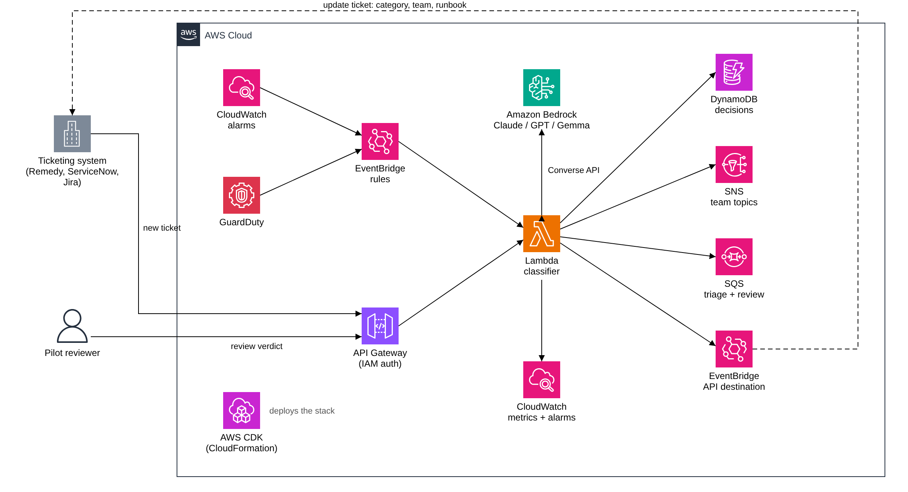

# AI Incident Classification with Amazon Bedrock

CLCS 660, Unit 6. Alerts and tickets are classified by a model on Amazon Bedrock, which picks the category, team and runbook. Answers outside the runbook catalog go to a person.



## Files

- `lambda/classifier.py` calls Bedrock (Converse API) and checks the answer against `lambda/catalog.json`
- `lambda/handler.py` saves the decision and routes it to a team or to the people queue
- `stack.py`, `app.py` CDK stack
- `evaluation/compare_models.py` runs closed tickets exported from the ticketing system through each model
- `pilot/pilot_report.py` picks the routing threshold from the pilot reviews
- `tests/` unit tests with a fake Bedrock client

## Modes

- `shadow` nothing reaches a team, everything goes to review (pilot)
- `assist` category and runbook are added to the ticket, a person assigns it
- `auto` tickets above the routing threshold go straight to the team

## Run

Enable model access in Bedrock and run `cdk bootstrap` once, then:

```
pip install -r requirements.txt
python -m pytest -q
python evaluation/compare_models.py <closed tickets export>
cdk deploy -c mode=shadow -c modelId=<model ID>
python pilot/pilot_report.py <DecisionsTable>
cdk deploy -c mode=auto -c routeAt=<threshold> -c ticketingUrl=<URL>
```

If the pilot report finds no threshold with 95% reviewer agreement, keep the stack in assist mode.
